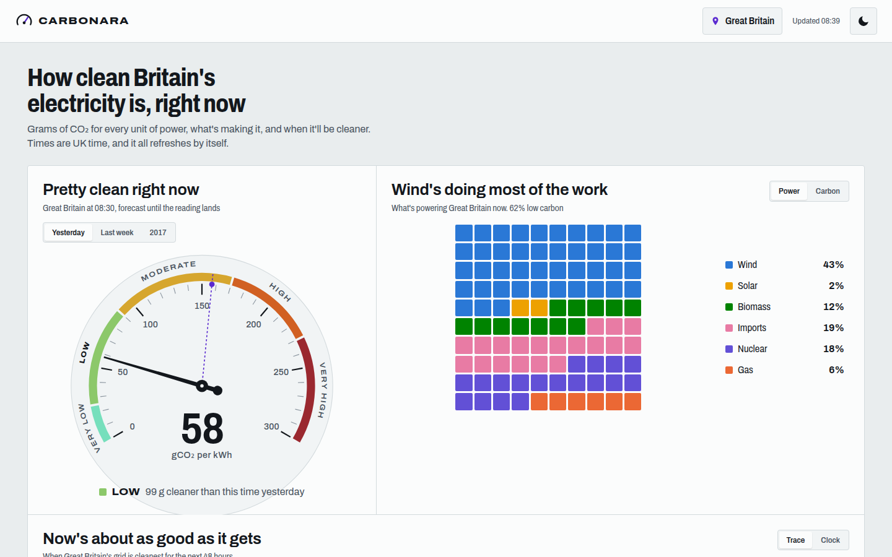

<h1 align="center">carbonara</h1>
<p align="center">
<i>How clean Britain's electricity is right now, where, and when it'll be cleaner</i>
<br />
<b>🌐 <a href="https://carbonara.peng.ly/">carbonara.peng.ly</a></b><br />
</p>

<p align="center">

</p>

<details>
  <summary>Contents</summary>

- [About](#about)
- [Deployment](#deployment)
- [Development](#development)
- [Credits](#credits)

</details>

## About

A live dashboard for Great Britain's electricity grid. It reads the [Carbon Intensity API](https://carbonintensity.org.uk/) and turns it into a barometer for right now, the mix of fuels behind it, a map you can play through the next 48 hours, and the best time to put the washing machine on.

Pick your area (or pop in a postcode) and the dial, the mix and the plug-in planner all switch to your bit of the grid. Times are UK time and it refreshes itself every few minutes.

---

## Deployment

### Option 1: Cloudflare Workers

This is how the live site runs. Fork it, change the `routes` in `wrangler.jsonc` to your own domain (or delete them to just get a `workers.dev` address), then:

```bash
npm install
ADAPTER=cloudflare npm run build
npx wrangler deploy
```

### Option 2: Docker

There's a multi-arch image on DockerHub ([`notaflightrisk/carbonara`](https://hub.docker.com/r/notaflightrisk/carbonara)) and GHCR ([`ghcr.io/notaflightrisk/carbonara`](https://github.com/NotAFlightRisk/carbonara/pkgs/container/carbonara)). With Docker installed, just run:

```shell
docker run -p 3000:3000 notaflightrisk/carbonara
```

### Option 3: From a release

Grab `site.zip` from the [latest release](https://github.com/NotAFlightRisk/carbonara/releases/latest), unzip it and run `node build`. There's nothing to install, it's all bundled. It listens on port 3000, or whatever you set `PORT` to.

### Option 4: Build from source

Follow the [Development](#development) steps, then `npm run build` and `node build`.

---

## Development

You'll need [Node](https://nodejs.org/) 22.12 or newer. It's a [SvelteKit](https://svelte.dev/docs/kit) app, so there's nothing else to set up, not even an API key.

```bash
git clone git@github.com:NotAFlightRisk/carbonara.git
cd carbonara
npm install
npm run dev
```

The dev server is then on [localhost:5173](http://localhost:5173). The other scripts you'll want are `npm run check` (types), `npm test` and `npm run format`. Alternativley, build the container with `docker build -t carbonara .`

The API is a free service, so the server caches everything it fetches - live readings for 5 minutes, the yearly stats for 12 hours - and browsers only ever talk to us, never to the API directly.

The region shapes in `src/lib/data/regions.json` come from NESO's [DNO licence areas](https://www.neso.energy/data-portal/gis-boundaries-gb-dno-license-areas). If they ever change, grab the GeoJSON and rebuild them with:

```bash
npx mapshaper dno.geojson -proj init=EPSG:27700 crs=EPSG:27700 -filter-islands min-area=25km2 remove-empty -simplify 2.5% keep-shapes -clean -o format=geojson precision=100 dno-simple.geojson
npm run regions -- dno-simple.geojson
```

---

## Credits

All the data comes from the [Carbon Intensity API](https://carbonintensity.org.uk/) by the National Energy System Operator (NESO), under [CC BY 4.0](https://creativecommons.org/licenses/by/4.0/). Region boundaries are from NESO's [open data portal](https://www.neso.energy/data-portal), under the NESO Open Data Licence. Thanks to both for keeping it free.

---

<!-- License + Copyright -->
<p  align="center">
  <a href="https://github.com/NotAFlightRisk"></a><br>
  <sup>
    <i>Licensed under <a href="../LICENSE">MIT</a>, © <a href="https://peng.ly">NotAFlightRisk</a> 2026</i>
  </sup>
</p>

<!--
oooh, hello there! hope you're having a nice day :)
   |\__      |\___
 (:> __)X  (:o ___(
   |/        |/
-->
